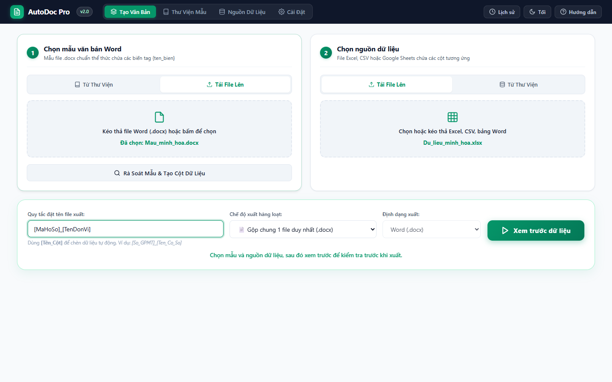
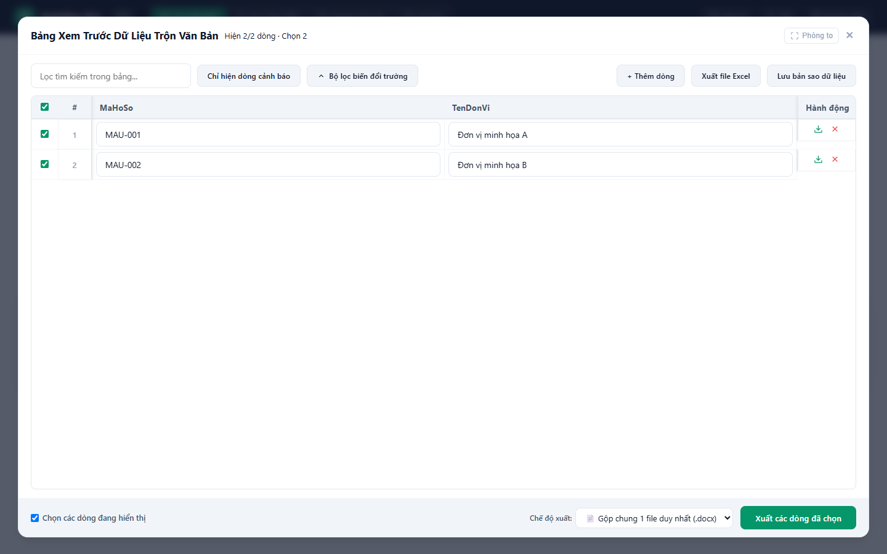
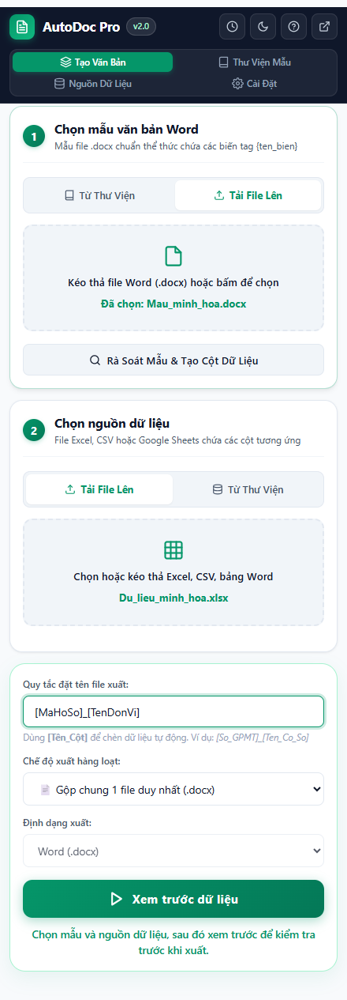

# Hướng dẫn sử dụng AutoDoc 2.0

AutoDoc tạo văn bản Word hàng loạt từ một mẫu `.docx` và bảng dữ liệu. Xem
[README](README.md) để biết đầy đủ tính năng, cách cài đặt và giới hạn hiện tại.

## 1. Chuẩn bị mẫu và bảng dữ liệu

Trong file Word, đặt biến bằng hai cặp ngoặc nhọn, ví dụ `{{HoTen}}` và
`{{DiaChi}}`. Bảng dữ liệu cần có cột `HoTen`, `DiaChi`; mỗi dòng tương ứng một
văn bản. Có thể dùng chức năng **Kiểm tra mẫu** để xem biến và tạo bảng dữ liệu
mẫu từ file Word.

Nguồn dữ liệu hỗ trợ file `.xlsx`, `.xls`, `.csv`, bảng trong `.docx`, liên kết
file và Google Sheets. Nếu file Excel có nhiều trang, chọn đúng trang tính.

## 2. Chọn nguồn và xem trước

Trong tab **Tạo văn bản**, chọn mẫu từ thư viện hoặc tải file `.docx` lên. Chọn
file dữ liệu từ máy hoặc một nguồn đã lưu trong tab **Nguồn dữ liệu**, rồi bấm
**Xem trước dữ liệu**.

Google Sheets được đọc lại mỗi lần mở xem trước. Trong bảng xem trước, bấm
**Cập nhật Google Sheets** để lấy dữ liệu mới theo yêu cầu. Nếu có cột `Check`,
chỉ dòng có `True` được đưa vào; nếu chỉ có `Check DL`, cột đó được áp dụng.
Dòng trống và dòng chỉ có `STT` hoặc dấu chọn sẽ bị bỏ qua. Chi tiết về truy cập
và chọn trang tính nằm trong [hướng dẫn Google Sheets](docs/google-sheets.md).

## 3. Kiểm tra và chỉnh sửa

Bạn có thể tìm dòng, sửa ô, thêm/xóa dòng, dán vùng nhiều ô từ Excel hoặc
Google Sheets, rồi đánh dấu những dòng cần xuất. Nút xuất ở từng dòng giúp thử
một văn bản trước khi chạy toàn bộ. Nút **Xuất Excel** tải dữ liệu đã chỉnh sửa;
**Lưu bản sao dữ liệu** lưu một bản trong thư viện, không ghi đè file gốc.

Nếu đã sửa dữ liệu trong bảng xem trước, hãy lưu bản sao trước khi cập nhật lại
Google Sheets để tránh mất các thay đổi cục bộ.

## 4. Xuất Word

Chọn tên file bằng cú pháp `[Tên_Cột]`, chẳng hạn `[SoVanBan]_[HoTen]`. Chọn
một trong ba chế độ: gộp các văn bản vào một file `.docx`, tải từng file `.docx`
hoặc đóng gói trong `.zip`. Bấm **Xuất các dòng đã chọn** và kiểm tra kết quả.
AutoDoc 2.0 chưa xuất PDF trực tiếp.

Nếu muốn làm việc cạnh trang tính, mở AutoDoc trong cửa sổ cạnh bên của Chrome:

## 5. Quản lý và xử lý sự cố

- Nếu báo thiếu biến, so sánh chính tả tên cột với nội dung giữa `{{` và `}}`
  trong mẫu Word.
- Nếu không thấy dòng Google Sheets, kiểm tra `Check`/`Check DL`, nội dung dòng,
  đúng trang tính và quyền truy cập của tài khoản Chrome đang dùng.
- Nếu Google yêu cầu đăng nhập, mở đúng link Sheet trong cùng hồ sơ Chrome rồi
  thử lại. Việc xuất bản Sheet có thể làm dữ liệu cập nhật chậm hơn link chỉnh sửa.
- Nếu cập nhật extension, bấm **Tải lại** tại `chrome://extensions` và mở lại giao
  diện AutoDoc.
- Sao lưu hoặc phục hồi thư viện bằng file `.json` trong tab **Cài đặt**.
